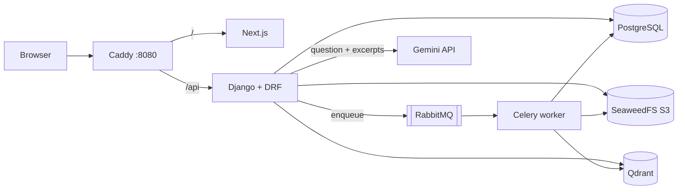

# AI Knowledge Hub

A multi-tenant document knowledge platform. Users create organizations, upload PDF / TXT / Markdown files, and ask
questions that are answered by Google Gemini **only from retrieved passages of their own organization's documents**,
with structured, server-validated citations.

Everything runs locally with Docker Compose. Nothing here is deployed anywhere, and it is a portfolio project, not a
production-hardened product (see [Limitations](#limitations)).

## Features

- Email/password accounts with Django session auth + CSRF (no tokens in `localStorage`)
- Organizations, memberships and roles (owner / admin / member) with a tested permission matrix
- Upload with content validation, stored in a private SeaweedFS (S3) bucket
- Asynchronous indexing (Celery + RabbitMQ): parse → chunk → local embeddings → Qdrant, with retries, idempotency and retry/re-index
- RAG chat: tenant-scoped retrieval, relevance threshold, bounded context, Gemini generation, validated citations, explicit "not enough information" answers
- Conversation history per user, citation side panel with the exact excerpt and a safe, authorized download of the original
- OpenAPI docs at `/api/docs/`

## Architecture



| System | Stores | Why |
|---|---|---|
| PostgreSQL | users, orgs, memberships, document metadata/state, chats, citation snapshots | relational integrity and transactions |
| SeaweedFS | original files | binary blobs behind an S3 API, private bucket |
| Qdrant | chunk vectors + retrieval payload | filtered ANN search |
| RabbitMQ | task messages | durable async work; the only Celery broker |

More detail, sequence diagrams for ingestion and Q&A, and the cross-store failure analysis:
[docs/architecture.md](docs/architecture.md) · [docs/rag-pipeline.md](docs/rag-pipeline.md) · [docs/security.md](docs/security.md) ·
[docs/project-plan.md](docs/project-plan.md) · [docs/worklog.md](docs/worklog.md) · [docs/adr/](docs/adr/).

## Stack

Python 3.12, Django 5.2, DRF, drf-spectacular, Celery, PostgreSQL 17, RabbitMQ 4, Qdrant, SeaweedFS, boto3,
sentence-transformers (CPU), `google-genai`, pypdf · Next.js (App Router), TypeScript strict, Tailwind, TanStack Query,
React Hook Form + Zod · Caddy · pytest, Ruff, mypy, Vitest, Playwright.

Redis is deliberately absent: there is no use for it that RabbitMQ/PostgreSQL don't already cover.

## Prerequisites

Docker with Compose v2, `make`, and a Gemini API key from <https://aistudio.google.com/apikey>.
For running tests outside Docker: [uv](https://docs.astral.sh/uv/), Node 24+, and `libmagic` (`apt install libmagic1`).

## Quick start

```bash
make env                # creates .env with random local secrets (never overwrites an existing one)
$EDITOR .env            # set GEMINI_API_KEY and check GEMINI_MODEL against https://ai.google.dev/gemini-api/docs/models
make up                 # builds images, runs migrations + bucket/collection init, starts everything
make ps                 # wait until services are healthy
```

The first build downloads the CPU PyTorch wheel and bakes the embedding model into the image (several GB, a few minutes).

Open <http://localhost:8080>, register, create an organization, upload a document, wait for **Indexed**, then ask a question.

| URL | What |
|---|---|
| <http://localhost:8080> | App (Caddy → Next.js) |
| <http://localhost:8080/api/docs/> | Swagger UI (OpenAPI schema at `/api/schema/`) |
| <http://localhost:8080/api/ready/> | Readiness (database + Qdrant) |
| <http://localhost:6333/dashboard> | Qdrant dashboard (localhost only) |
| <http://localhost:15672> | RabbitMQ management (credentials from `.env`) |
| <http://localhost:8080/django-admin/> | Django admin (superuser, see below) |
| <http://localhost:8333> | SeaweedFS S3 endpoint (credentials from `.env`; localhost only) |
| <http://localhost:8888> | SeaweedFS filer web UI: browse the bucket at `/buckets/contextforge-documents/` (no login, localhost only) |
| <http://localhost:9333> | SeaweedFS master UI (no login, localhost only) |

Only Caddy, Qdrant, RabbitMQ management and SeaweedFS (S3, filer, master) are published, all bound to `127.0.0.1`. PostgreSQL is not published.

Useful commands: `make logs`, `make down`, `make reset` (**deletes all data volumes**), `make migrate`, `make reindex`.

Sample documents for trying it out live in `backend/tests/fixtures/` (synthetic).

## Demo data and logins (local only)

A realistic corpus makes search, chat and the dashboards worth looking at. Everything is public/open content, downloaded on demand (never committed; `data/` is gitignored):
IETF RFCs (HTTP, TCP, TLS 1.3, OAuth2, JWT, DNS, SMTP…, as `.txt` and one `.pdf`), arXiv papers (Transformer, BERT, RAG; PDF),
Project Gutenberg novels (public domain) and chapters of *The Rust Programming Language* (MIT/Apache-2.0).

```bash
make seed     # = fetch corpus + create the superuser + register users, orgs, roles and upload ~42 documents through the real API
make creds    # print every login (demo users + RabbitMQ/SeaweedFS secrets read from your .env)
```

`make seed` is idempotent and takes a few minutes to finish indexing (CPU embeddings, ~12k chunks). It uses the same HTTP API as the browser, so it also exercises validation, storage, the queue and Qdrant.
**The demo password is public (`Demo-Pass-2026!`) — never use this seed on anything reachable from a network.**

| Login (all use `Demo-Pass-2026!`) | Role(s) | Notes |
|---|---|---|
| `owner@acme.test` | **owner** of Acme Engineering | RFCs + papers (16 docs). Full control: upload, delete, manage members/roles |
| `admin@acme.test` | **admin** of Acme Engineering and Globex Library | manage members (not the owner), upload, delete |
| `member@acme.test` | **member** of Acme Engineering and Initech Docs | read, chat, download; no delete/manage controls |
| `owner@globex.test` | **owner** of Globex Library | 8 public-domain novels |
| `multi@demo.test` | **owner** Initech Docs, **admin** Globex Library, **member** Acme Engineering | role differs per organization (Rust book chapters in Initech) |
| `outsider@demo.test` | no organization | tenant-isolation checks: every org URL returns 404 |
| `admin@contextforge.test` | Django **superuser** | <http://localhost:8080/django-admin/>: users, orgs, memberships, documents (read-only) |

Infrastructure dashboards:

| Dashboard | URL | Login |
|---|---|---|
| Qdrant | <http://localhost:6333/dashboard> | none; collection `knowledge_chunks` (vectors + payloads per chunk) |
| RabbitMQ management | <http://localhost:15672> | `RABBITMQ_USER` / `RABBITMQ_PASSWORD` from `.env` |
| SeaweedFS filer (S3 bucket browser) | <http://localhost:8888/buckets/contextforge-documents/> | none (localhost only) |
| SeaweedFS S3 API | <http://localhost:8333> | `S3_ACCESS_KEY` / `S3_SECRET_KEY` from `.env`, e.g. `aws --endpoint-url http://localhost:8333 s3 ls s3://contextforge-documents --recursive` |
| PostgreSQL | not published | `docker compose exec db psql -U $POSTGRES_USER -d $POSTGRES_DB` |

The infra secrets are random per machine (generated by `make env`), which is why they live in `.env` and are printed by `make creds` instead of being written here.

Things to try in the browser: sign in as each role and compare the Documents/Members pages; ask Acme "How does TLS 1.3 handshake authentication work?" or "What is the difference between GET and POST?";
ask Globex "Who is Elizabeth Bennet?"; ask Initech "What are lifetimes in Rust?"; ask Acme about *Pride and Prejudice* (it lives in a different tenant, so you get the explicit "not enough information" answer).

## Configuration

All settings are environment variables; see [.env.example](.env.example). Important ones:

| Variable | Purpose |
|---|---|
| `GEMINI_API_KEY`, `GEMINI_MODEL` | generation; the model id is **not** hardcoded—verify a currently supported id (retired ids return 404 "no longer available to new users"; list yours with `GET /v1beta/models?key=…`) |
| `GEMINI_FALLBACK_MODEL` | optional second model tried once when the primary keeps failing (e.g. Google 503 "high demand") |
| `GEMINI_MAX_ATTEMPTS` | retries on the primary model for 429/5xx (default 4) |
| `EMBEDDING_MODEL`, `EMBEDDING_DIMENSIONS` | local embedding model (must match; startup validates) |
| `CHUNK_SIZE`, `CHUNK_OVERLAP` | characters per chunk / overlap |
| `RAG_TOP_K`, `RAG_SCORE_THRESHOLD`, `RAG_MAX_CONTEXT_CHARS` | retrieval and context bounds |
| `MAX_UPLOAD_BYTES` | upload cap (Caddy additionally caps request bodies at 12 MB) |
| `S3_*`, `QDRANT_*`, `POSTGRES_*`, `RABBITMQ_*` | service credentials |

Changing the embedding model or chunking: if dimensions change use a new `QDRANT_COLLECTION`, then run `make reindex`.

## How it works (short)

**Indexing.** Upload → validate (extension, size, magic bytes, UTF-8) → object key `orgs/{org}/documents/{uuid}.ext` in SeaweedFS →
DB row `pending` → Celery task with only the document id → row claimed (`processing`) → parse (PDF pages / Markdown sections) → overlapping chunks →
local embeddings → deterministic-id upsert into Qdrant → `indexed`. Failures become `failed` with a safe message and can be retried.

**Answering.** Membership check → embed question → Qdrant search **filtered by the server-resolved organization** → drop hits whose document is not currently `indexed` in PostgreSQL →
bounded `<source>` blocks → Gemini → JSON answer; citation ids not in the retrieved set are discarded. No evidence means no LLM call and an explicit insufficient-context reply.

**Isolation.** Org context comes from URL + session membership (404 for non-members), all queries are org-scoped, Qdrant calls cannot be made without an org, tasks re-read the DB row,
downloads are authorized streams. See [docs/security.md](docs/security.md).

## Development and testing

```bash
make test-backend   # starts a throwaway Postgres on :55432, runs pytest (S3=moto, Qdrant=in-memory, embedder=hashing, Gemini=fake)
make lint-backend   # ruff check, ruff format --check, mypy
make test-frontend  # tsc, eslint, vitest
make e2e            # Playwright against the running stack, after `make seed` (see frontend/e2e/README)
make check          # everything CI runs
```

Backend tests need no Gemini key and no paid API. They cover auth, roles, upload validation, storage adapter (moto), lifecycle and retries,
chunking, Qdrant tenant filtering, retrieval quality fixtures, citation validation, prompt-injection handling and cross-tenant denial across API, downloads,
conversations, vectors, tasks, deletion and re-indexing. CI: `.github/workflows/ci.yml`.

## Troubleshooting

| Symptom | Fix |
|---|---|
| `make up` fails on `init` | `docker compose logs init`; usually a service not yet healthy or a wrong credential in `.env`. Re-run `make up`. |
| Chat answers "temporarily unavailable" | `GEMINI_API_KEY` missing/invalid or `GEMINI_MODEL` not available to your key. See `docker compose logs api` (no secrets are logged). |
| Document stuck in *Processing* | Check `docker compose logs worker`. Stale claims are recoverable after `PROCESSING_STALE_SECONDS`; press Retry. |
| Document *Failed*: "queue unavailable" | RabbitMQ was down at upload time. Press Retry. |
| Qdrant "dimension" error on startup | The existing collection has different dimensions than `EMBEDDING_DIMENSIONS`. Use a new `QDRANT_COLLECTION` and `make reindex`. |
| Port 8080 in use | Set `APP_PORT` and `DJANGO_CSRF_TRUSTED_ORIGINS` accordingly in `.env`. |

## Limitations

- Local HTTP only; no TLS, MFA, e-mail verification, password reset, audit log or virus scanning.
- Members are added by e-mail and must already be registered (no invitation flow).
- Scanned/image-only PDFs are not supported (no OCR). Text files must be UTF-8.
- Default embedding model is small and English-oriented; retrieval quality on other languages or long tables will be weaker.
- No streaming responses; an answer is returned when generation finishes.
- Orphaned objects (upload succeeded, DB write failed *and* cleanup failed) are not swept automatically.
- Question text and retrieved excerpts are sent to Google's Gemini API.
- One Celery worker image runs the embedding model in-process; no GPU support is configured.

## License

MIT (see [LICENSE](LICENSE)), as chosen by the repository owner.
