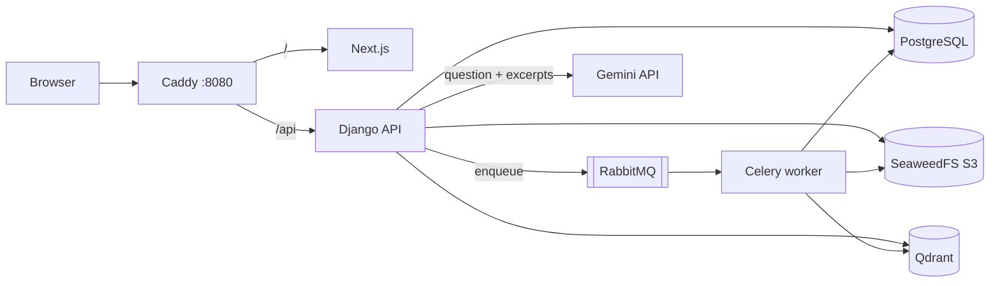
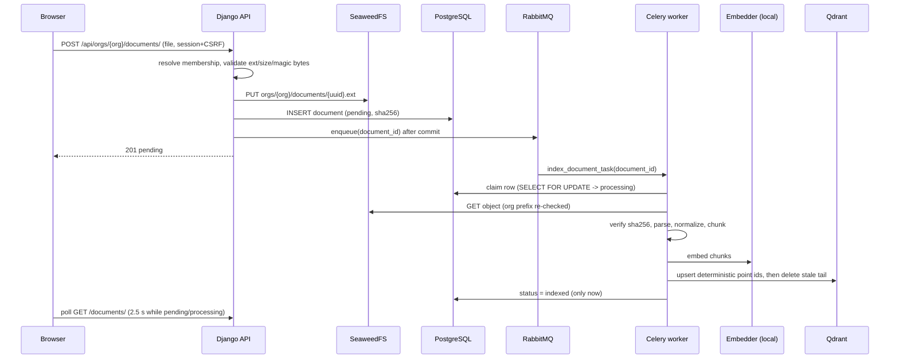
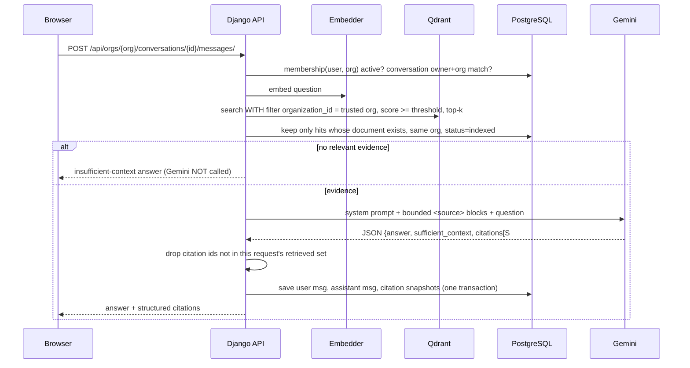

# Architecture

## Components and responsibilities

| Component | Responsibility | Why it owns this |
|---|---|---|
| **Caddy** | Single browser-facing origin (`http://localhost:8080`). Routes `/api/*` to Django and everything else to Next.js. Caps request bodies. | Same origin means first-party session cookies and no CORS surface. |
| **Next.js** | UI only. Holds no secrets and talks to the API with relative URLs. | Keeps presentation separate from business rules; authorization is never decided here. |
| **Django + DRF** | Auth, tenancy, authorization, upload validation, orchestration of RAG. Views are thin; logic lives in `services.py` / `pipeline.py`. | One place that enforces who can do what. |
| **PostgreSQL** | System of record: users, organizations, memberships, document metadata and state, conversations, messages, citation snapshots. | Relational integrity, constraints, transactions. |
| **SeaweedFS (S3)** | Original uploaded bytes, in a private bucket. | Binary blobs do not belong in the database; S3 API keeps the adapter portable. |
| **Qdrant** | Chunk vectors plus a retrieval payload (org, document, chunk, page, text). | Purpose-built ANN search with payload filtering. |
| **RabbitMQ** | Transports indexing/deletion tasks to Celery. | Durable queue so slow work (parsing, embedding) never blocks a request. |
| **Celery worker** | Runs `index_document_task` / `delete_document_task` using the same Django domain services. | Shares code with the API; no separate microservice. |
| **Gemini API** | Generates the answer from retrieved passages. | External; only bounded excerpts are sent. |

## Django apps

`accounts` (custom email user, session auth) · `organizations` (tenant, membership, permission matrix) ·
`documents` (model, storage adapter, validation, parsing, chunking, lifecycle, tasks) ·
`rag` (embedding interface, Qdrant adapter, retrieval, prompts, LLM adapter, pipeline) ·
`chat` (conversations, messages, citations) · `core` (health, errors, pagination, ops commands).

`rag` is intentionally free of HTTP and chat persistence, so a reranker, hybrid search or another LLM can
be added by changing `retrieval.py` / `llm.py` only.

## Document ingestion

## Question answering

## Coordinating PostgreSQL, Qdrant and object storage

These three systems cannot commit atomically. The design chooses an order for each operation so that a crash leaves
a state that is *detectable and recoverable*, and never a false success.

| Failure | Resulting state | Recovery |
|---|---|---|
| Object stored, DB insert fails | Orphan object, no row. Best-effort delete runs immediately. | Orphans are invisible and unreferenced; a periodic bucket sweep is future work. |
| Row committed, broker down at enqueue | Row marked `failed` with "queue unavailable". | User/admin presses Retry. |
| Worker crashes mid-index | Row stays `processing`. | After `PROCESSING_STALE_SECONDS` the claim is stale and a retry/`reindex_stale` re-claims it. `acks_late` also redelivers the message. |
| Vectors upserted, DB update fails | Vectors exist but row is not `indexed`; retrieval ignores it (DB re-validation). | Task retry overwrites the same deterministic point ids. |
| Re-index with fewer chunks | Old tail chunks would linger. | `delete_stale_chunks` removes `chunk_index >= n` after the new upsert (no empty window). |
| Delete: vectors removed, object delete fails | Row remains `deleting` (hidden from users and retrieval). | Task retries with backoff. Row is deleted last. |
| Delete during indexing | Worker sees `deleting` at finalisation, removes the vectors it wrote, does not mark indexed. | — |

Idempotency: Qdrant point id = `uuid5(document_id, chunk_index)`; tasks no-op for `indexed` / `deleting` documents
or fresh `processing` claims.

## Configuration changes and re-indexing

Each indexed document records `indexed_with` (embedding model + chunk size + overlap). Changing the embedding model,
dimensions, or chunking requires a new collection when dimensions change (startup refuses a mismatched collection) and
`make reindex` (`reindex_stale`) to re-queue documents whose signature differs.

## Observability

Structured one-line logs with a request id (`X-Request-ID`). Document text, prompts, credentials and API keys are not logged.
`/api/health/` (liveness) and `/api/ready/` (database + Qdrant) back the Docker health checks. No metrics stack is included.
